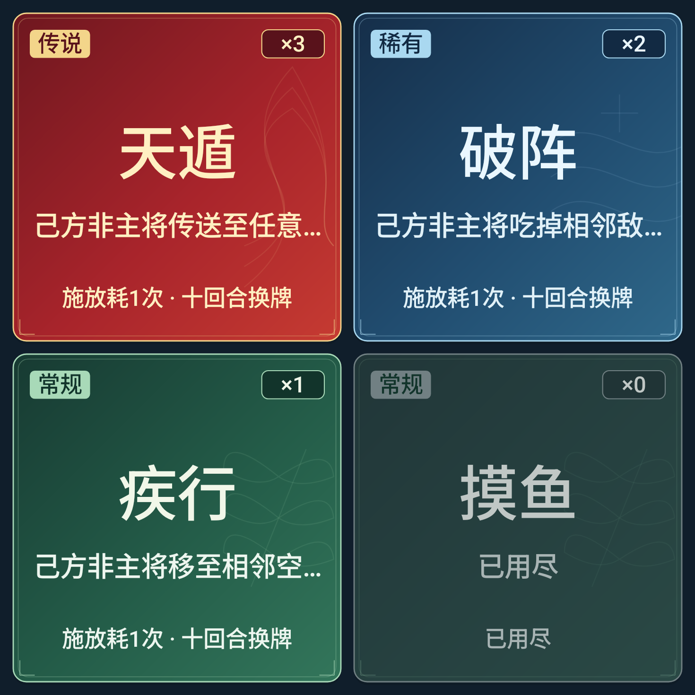

# 技能卡牌品质系统 · v4.6

## 统一配置

`SkillCardTheme`负责品质映射与颜色，`SkillCardPainter`负责卡面材质、信息排布与状态。抽卡揭晓卡面及对局底部技能卡共用这套绘制器，无需为30种技能逐个写外观。

| 品质 | 原始数据映射 | 渐变色 | 边框 / 徽章底 | 标题 | 纹样 |
| --- | --- | --- | --- | --- | --- |
| 传说 legendary | 原传说，6种 | #6E171F → #A8242B → #C63B32 | #F3D58A | #FFF0C2 | 低透明金色流焰、云气曲线 |
| 稀有 rare | 原奇策，10种 | #152E49 → #214D70 → #2F688A | #A9D8F0 | #EAF7FF | 水纹、星芒 |
| 常规 common | 原常规及整活，14种 | #173A32 → #245D49 → #33765B | #A8D9B8 | #F1F7E9 | 竹叶、玉纹 |

原`SkillRules.tier()`以及技能ID、名称、效果、随机次数、抽牌概率均未改变。原“奇策”在卡牌界面显示为“稀有”；整活牌使用常规卡面，但在完整卡牌底部、技能详情与无障碍标签保留“整活”标识。

## 信息层级

完整卡面：左上品质徽章、右上真实剩余次数×N、中部主标题、单行简短说明、底部真实规则。规则显示“施放耗1次 · 十回合换牌”，不使用与现行随机1～3次矛盾的“每局一次”。长说明以省略号收尾，完整效果继续在确认弹窗中展示。

短卡面：保留品质、×N、主标题、简短说明；当卡高不足76dp时省去底部次要规则，完整使用规则仍可在详情弹窗查看，避免缩小棋盘来容纳额外信息。短卡无可用目标时明确显示“暂无合法目标”；等待回合及已用尽同理。

抽卡页各方向均两列两行，翻牌背面统一中性深蓝，翻开后才显示品质、名称和次数。对局技能区延续v4.5响应式布局：竖屏两列两行，常规手机横屏两列，极矮横屏和宽窗口单排四张；不挤占棋盘和工具栏。

## 材质与状态

外边约0.8dp、内边0.45dp，角落小型回纹、低透明品质纹样、7～8dp圆角、柔和下投影。选中边框提升为1.4dp并使用对应品质亮色，增加轻微亮度和短暂光泽扫过；不持续闪烁。关闭系统动画时不播放光泽动画。

禁用卡使用灰蓝混合降低亮度和饱和度，并显示原因；剩余次数取自真实棋局，耗尽显示×0。仅无合法目标但仍有次数时保留实际数字，不能伪装为0。

默认翻牌320ms、逐张90ms错峰、全部揭晓、跳过动画、进入对局、目标选择、次数扣减和十回合换牌流程保持原样。底部技能卡的选中光泽约340ms，仅状态从未选中变为选中时触发。

## 可读性与适配

完整卡标题最高24sp，说明11sp，徽章9sp；短卡标题最高16sp、说明10sp，按真实卡宽高限制，标题和说明单行省略。渐变三个色站与标题及说明文字均检查至少4.5:1对比度；传说标题对最亮红色站约4.54:1，稀有5.55:1，常规4.95:1。

弹窗以安全区域内的可用宽高测量。横屏不足440dp高，或大字体不足600dp高时，压缩标题和详情的外围空间，保留两行卡片至少44dp触摸高度及三个原有操作按钮。

所有纹样由原生Canvas路径绘制，无需新增PNG素材，不引入下载图片、静态棋盘或业务逻辑替代物。

## 生产绘制器预览

以下为同一生产绘制器以固定技能/次数生成的样本，包含三种品质和已用尽状态；不是替代可交互卡片的背景图片。

